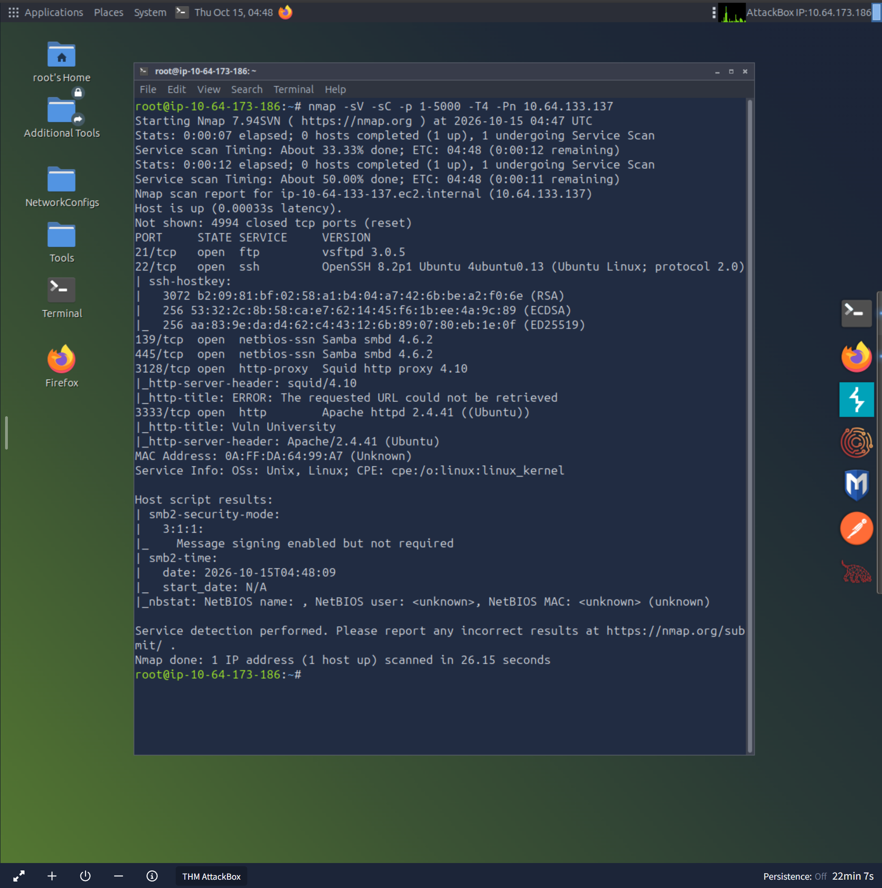
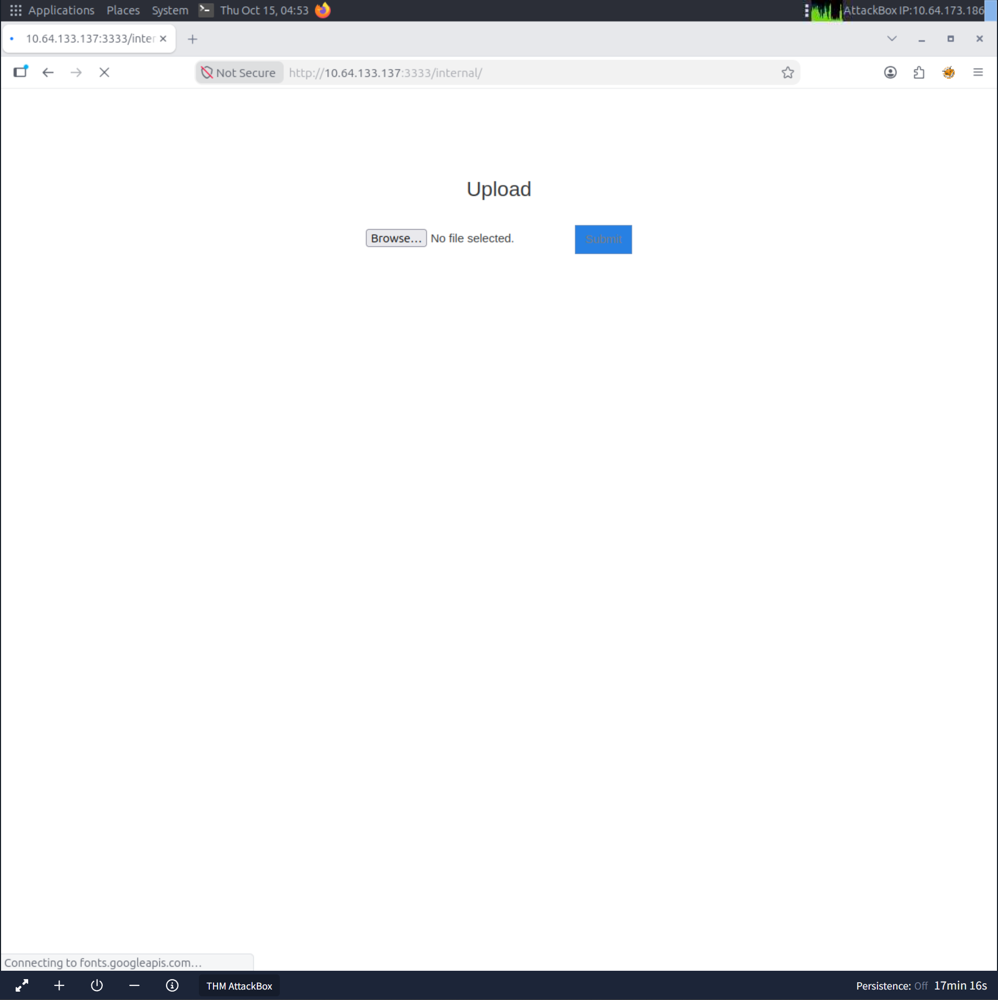

# Caso de Estudio: Auditoría Web y Explotación de Vulnerabilidad Server-Side (Unrestricted File Upload)

**Autor:** Miguel Sevillano 
**Nivel:** Practicante / Junior
**Entorno de Laboratorio:** TryHackMe (Red Interna Aislada)
*   **IP Atacante (Local):** `10.64.173.186`
*   **IP Objetivo (Servidor):** `10.64.133.137`

**Objetivo:** Identificar servicios ocultos, evaluar vulnerabilidades en aplicaciones web (Server-Side) y proponer controles de mitigación.

---

## 1. Fase de Reconocimiento y Enumeración
Se inició la auditoría desde el equipo atacante (`10.64.173.186`) con un escaneo de puertos sobre la dirección IP objetivo utilizando `Nmap` para mapear la superficie de ataque y evadir restricciones de ping (`-Pn`).

**Comando ejecutado:**
`nmap -sV -sC -p 1-5000 -T4 -Pn 10.64.133.137`

**Resultados Críticos:**
Durante el escaneo se identificaron servicios estándar (FTP, SSH) y un servidor web Apache oculto operando en un puerto no convencional:
*   **Puerto 3333 (HTTP):** Servidor Apache httpd 2.4.41 ejecutando una aplicación web de gestión universitaria ("Vuln University").

---

## 2. Identificación de la Vulnerabilidad
Al realizar *Directory Fuzzing* sobre el servidor web en el puerto 3333, se descubrió un directorio oculto en la ruta `http://10.64.133.137:3333/internal/`. 
Este directorio alojaba un formulario de subida de archivos (Upload Form) que presentaba deficiencias en la validación de los datos de entrada por parte del servidor.

---

## 3. Explotación (Bypass de Filtros con Burp Suite)
Se procedió a evaluar la seguridad del formulario intentando subir archivos con extensiones ejecutables. 

1.  **Intercepción:** Se utilizó **Burp Suite** configurado como proxy inverso en la máquina atacante para interceptar la petición HTTP POST enviada al servidor `10.64.133.137`.
2.  **Análisis del Filtro:** Se detectó que el servidor contaba con un filtro básico (Blacklist) que bloqueaba archivos con la extensión estándar `.php`.
3.  **Bypass:** Modificando la petición directamente en Burp Suite, se alteró la extensión del archivo a `.phtml`. El servidor aceptó el archivo, demostrando una vulnerabilidad crítica de **Unrestricted File Upload**.
4.  **Impacto:** Esta vulnerabilidad permitiría a un atacante alojar una Web Shell y lograr Ejecución Remota de Comandos (RCE) en el servidor.

---

## 4. Remediación y Controles Propuestos (Visión Defensiva)
Para mitigar esta vulnerabilidad y alinear la infraestructura a buenas prácticas de desarrollo seguro, se recomiendan los siguientes controles preventivos:

*   **Implementar Whitelisting de Extensiones:** Rechazar por defecto cualquier archivo que no cumpla con extensiones explícitamente permitidas y necesarias para el negocio (ej. permitir solo `.jpg`, `.png`, `.pdf`).
*   **Validación de Magic Bytes:** No confiar únicamente en la extensión del archivo proporcionada por el usuario. El backend debe verificar la firma del archivo (Magic Numbers) para asegurar que el contenido coincide de forma estructurada con el tipo MIME declarado.
*   **Renombrado Aleatorio:** Almacenar los archivos subidos utilizando nombres generados aleatoriamente (ej. hashes UUID o cadenas alfanuméricas complejas) para evitar que un atacante adivine la ruta absoluta de su archivo malicioso.
*   **Aislamiento de Directorios:** Asegurar que el directorio de "uploads" no tenga permisos de ejecución a nivel de servidor web (ej. deshabilitar la ejecución de scripts en las carpetas de almacenamiento de medios).